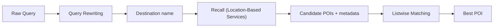

**Team:** Search

**Period:** Spring 2026

## What I Worked On

I interned at TikTok Search team during 2026 spring. I primarily worked on serving and scaling location signals to the search engine for downstream retrieval and ranking. I worked with C++ and Python.

### Optimising Small Language Models (SLM) for local search

I designed and optimized **Small Language Models** for **query rewriting** and **Point of Interest (POI) listwise selection**. Given a query with a local life service intent, the pipeline works as follows:

1. **Query rewriting**: rewrite the raw query to a POI name (e.g. *best hotels in bali* → *bali*)
2. **Recall**: retrieve a list of candidate POIs and their metadata using location-based and vertical recall
3. **Listwise matching**: select the single POI that best matches the original query

To enable resource-efficient serving, I first gathered millions of search logs and labelled them using a data pipeline based on a larger LLM. Since annotation was I/O-bound, I parallelized it with **multithreading** to keep many requests in flight at once. 

As we needed a resource-efficient and lightweight model (in terms of latency and size), I decided to apply **model distillation** with Supervised Fine Tuning (SFT) along with **GRPO** post-training to optimize the small language model.

For GRPO, I designed the reward function to grade the quality of each JSON response and its adherence to the required schema and output format, reinforcing outputs that were both accurate and reliably serializable.

The models were trained using a **8x NVIDIA GPU cluster** (!) using **ZeRO optimization**. This meant instead of duplicating the optimizer states, gradients and parameters on every GPU, ZeRO (Zero Redundancy Optimizer) partitions them across the 8 GPUs:

| ZeRO stage | What is sharded across GPUs |
| --- | --- |
| Stage 1 | Optimizer states (e.g. Adam momentum and variance) |
| Stage 2 | Optimizer states + gradients |
| Stage 3 | Optimizer states + gradients + model parameters |

This helped freed up GPU memory for larger per device batch sizes and longer sequences, which shortened each distillation and GRPO iteration. To further squeeze performance and memory, I applied **bf16 mixed precision**, which roughly halves activation memory and runs matmuls on the GPU's tensor cores, while keeping fp32's dynamic range so no loss scaling was needed.

I also brainstormed and applied novel data augmentations to compact and transform the training data, reducing deployment resource requirements and simplifying the inference scenario for the model. Initially, this required 4 models (2 for fuzzy/exact queries, 1 for rewrite, 1 for listwise selection) for this complex task, I managed to reframe and review the problem in an unorthodox way, and eventually I produced a unified single model after repeated improvement iterations.

To further squeeze performance and efficiency, I experimented with parameter efficient fine tuning techniques such as **LoRA** and **QLoRA**. Afterwards, I evaluated each checkpoint with **vLLM**, whose PagedAttention and continuous batching made batch scoring on the golden set fast enough to compare many runs. 

As we did not have a set of 'golden' labels, I proposed and implemented a LLM as a judge with enriched RAG approach to evaluate the performance of the models.

Eventually, after many rounds of optimization and performance measurements, the final model achieved **~94% precision/recall**.

### Location Signal Retrieval Engine

I designed a **multimodal vertical-based recall engine** to resolve a upstream recall issue, combining 3 recall modules:

| Module | Description |
| --- | --- |
| Google-based recall | Leverages places signals as an additional recall source |
| Video anchor multimodal recall | Uses multimodal signals from video anchors to surface relevant POIs |
| Vertical places recall | Taps vertical-specific place information for finer-grained coverage |

### Nearline Cache Arhitecture

The location signals I worked on are served across 3 layers, offline, nearline and online. The ultimate goal is to have a good coverage when a search happens.

| Tier | Latency | How it works |
| --- | --- | --- |
| **Offline** | Daily job | Batch jobs (e.g. Spark) produce precomputed signals written to a data cache |
| **Nearline** | Milliseconds (cached) | A streaming pipeline (e.g. Kafka/Flink) continuously updates a fast cache so signals are pre-computed but recent |
| **Online** | Milliseconds | Signals are computed live at query time |

I deployed a **Kafka & Flink** nearline cache architecture to continuously ingest queries and update its location signals, serving them to the main search engine in low latency. After integrating the core functionality, I added a observability layer to monitor its metrics (throughput, cache hit rate, latency, etc).

As a result of this nearline solution, we observed a significant increased coverage across location signals. Consequently, this had resulted in an improvement of conversion rate by **1.1%**, while also serving thousands of queries per second (QPS).

### Data Engineering ETL Expansion

We had an existing ETL pipeline, using **Spark** and **Hive** for data processing alongside separate internal RPC services. It lacked sufficient query intent coverage across many regions. This limited how well downstream retrieval and ranking could serve local queries. To fix this, I enhanced it with **posterior signals** (后验数据) aggregated from user click behaviour in historical search sessions.

I proposed an idea which was to estimate whether a query has **exact** or **fuzzy** intent by looking at how concentrated its clicks are:

- **Exact intent**: clicks are isolated and concentrated on a single POI (e.g. users searching *"McDonald's Orchard"* almost always click the same specific outlet). The query maps very clearly to one specific target.
- **Fuzzy intent**: clicks are spread across many POIs (e.g. *"good coffee near me"* lands on different cafes each time). The query expresses a category or preference rather than a specific destination.

Converting this into a rule based formula, this classification feeds downstream signals with a more precise prior on what the user actually wants, allowing retrieval and ranking to weight exact-match signals more heavily for exact queries and broaden recall for fuzzy ones. This boosted downstream signal coverage by **10+%**.

### Anchor Search with Multilingual BERT

To serve location signals in real-time, Small Language Models are not feasible as they take too long. To tackle this, I distilled and tuned a **BERT** model for named entity recognition and pointwise re-ranking, to serve multiple regions.

In contrast to the SLM in the nearline layer, it can afford to be **listwise** in POI matching stage as it receives the full candidate list and scores items relative to one another, capturing inter-candidate dependencies. This is more expressive but requires encoding all candidates together, making latency grow with list size.

At query time, anchor search runs **online**, which meant every millisecond mattered. A **pointwise** model scores each candidate independently, which means it can run in parallel across candidates and its latency stays constant regardless of list size. The cost is that it cannot compare candidates against each other directly, but for NER and first-pass ranking this is an acceptable trade-off.

