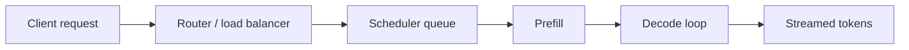

## Overview

## Request Lifecycle

## Batching

### Static batching

### Dynamic batching

### Continuous batching

## Scheduling

### Admission control

### Preemption

### Chunked prefill

## Memory Management

### PagedAttention

### KV cache eviction and offloading

## Routing and Scaling

### Prefix-aware routing

### Autoscaling

### Multi-LoRA serving

## Serving Frameworks

| Framework | Notes |
| --- | --- |
| vLLM | |
| SGLang | |
| TensorRT-LLM | |
| TGI | |

